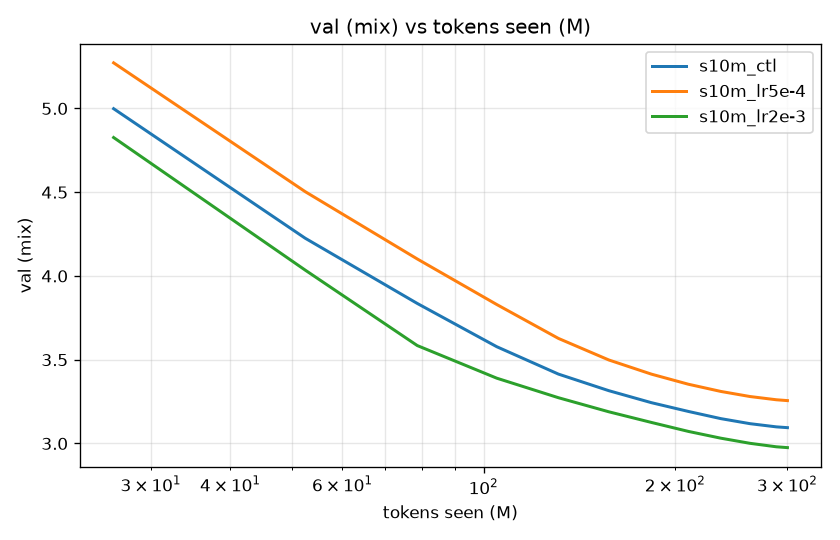
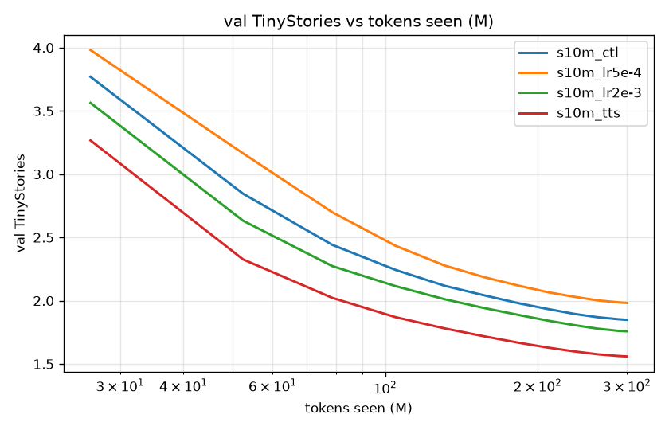

# 对比实验结果

实验计划见 [06-experiments.md](../design/06-experiments.md)。本文件记录实际结果。所有数字和图都可以用文末命令重新生成。

| 实验 | 变量 | 状态 |
|---|---|---|
| A | 模型规模 0.01B / 0.05B / 0.1B | ✅（含五人盲评） |
| B | 采样参数（temperature × top-k，greedy，top-p） | ✅ |
| C | 分词方式（字符级 vs BPE） | ✅ |
| D | 训练设置（lr ×0.5 / ×2、只用 TinyStories） | ✅ |

**总结论**

1. **规模**：参数越多 val loss 越低，但收益递减（3.098 → 2.543 → 2.409）；相同已训练 token 数下大模型也更低。写简单故事 0.05B 已经接近上限，说明文到 0.1B 还在进步，但事实仍然经常是编的。
2. **采样**：greedy / 低温度会整句复读，T=1.5 会编出不存在的词；top-k=50 能在高温下兜底。推荐 T=0.7–0.8 + top-k=50。
3. **分词**：不同分词器的 loss 不能直接比，换算成 bits-per-byte 后，相同 token 预算下 BPE 明显优于字符级（SmolLM 1.367 vs 1.602）。
4. **训练设置**：s10m 上 lr 2e-3 比 1e-3 好（3.094 → 2.975），5e-4 欠拟合（3.256）；只用 TinyStories 把 TinyStories val 从 1.849 降到 1.559，但失去 SmolLM 能力。本机对照与云端 s10m 只差 0.13%。

---

## 实验 A：模型规模

### 设置

| 固定 | 值 |
|---|---|
| 数据 | SmolLM 1B 子集 + TinyStories，同一组 bin，自然比例混合（70.3% : 29.7%） |
| 分词器 | 同一个 BPE-8192 |
| 有效 batch | 256 × 512 = 131072 token/步 |
| 调度 | warmup 200 步 + cosine 衰减到 lr/10 |
| 其余 | AdamW β=(0.9, 0.95)，weight decay 0.1，grad clip 1.0，seed 1337，bf16 |

| 变化 | s10m | s50m | s100m |
|---|---|---|---|
| 层 / 维 / 头 | 6 / 384 / 6 | 10 / 640 / 10 | 14 / 768 / 12 |
| 峰值 lr | 1e-3 | 6e-4 | 4e-4 |
| 训练 token | 3 亿 | 10 亿 | 15 亿 |
| 配置 | `configs/s10m.yaml` | `configs/s50m.yaml` | `configs/s100m.yaml` |

三个模型都在云端 RTX 5090 上一次训练完成（2026-11-15），中间没有续训。

### 最终结果

| 模型 | 总参数 | 非 emb 参数 | 训练 token | val（加权） | val SmolLM | val TinyStories | 困惑度 | 训练时长 | 平均 tok/s | 显存峰值 | ckpt 文件 / 仅权重 | 生成速度* |
|---|---|---|---|---|---|---|---|---|---|---|---|---|
| s10m | 13.99M | 10.65M | 0.30B | 3.098 | 3.629 | 1.845 | 22.2 | 4.6 min | 1117k | 9.2 GB | 168 / 56 MB | ~360 tok/s |
| s50m | 54.81M | 49.24M | 1.00B | 2.543 | 3.016 | 1.426 | 12.7 | 45.2 min | 370k | 10.4 GB | 658 / 219 MB | ~290 tok/s |
| s100m | 105.92M | 99.23M | 1.50B | 2.409 | 2.865 | 1.330 | 11.1 | 115.9 min | 216k | 16.5 GB | 1271 / 424 MB | ~200 tok/s |

- val 取训练结束时最后一次评估（与 `ckpt_best.pt` 相同，三个模型的 val loss 都是一路下降，最好的就是最后的）。表由 `src/plot_compare.py` 生成，原表在 `figures/results.md`。
- \* 生成速度：本地 RTX 5060 Ti，batch=1，200 个新 token，没有 KV cache（见 `samples_A.md`）。小模型生成也只快不到 2 倍：每一步都要从 Python 发起一次完整前向，batch=1 时 GPU 大部分时间在等，速度主要受每步固定开销限制，而不是计算量。

### 相同已训练 token 数下的比较

训练时每 200 步才评估一次，3 亿 token 处最近的一次评估在 2.88 亿。所以这里用 `src/evaluate.py` 对训练中途保存的 `ckpt_tok*.pt` 重新评估：每个 checkpoint 都在**同一批** 0.82M 个验证 token 上计算 loss。

| 已训练 token | s10m | s50m | s100m |
|---|---|---|---|
| 1 亿 | 3.592 | 3.357 | 3.357 |
| 3 亿 | **3.082**（训练结束） | 2.843 | 2.810 |
| 10 亿 | — | **2.529**（训练结束） | 2.467 |
| 15 亿 | — | — | **2.394**（训练结束） |

加粗的是各模型训练结束时的值（学习率已经衰减到最低）。其他格子是训练中途的值，那时学习率还很高，**loss 比"专门只训练到这么多 token"偏高**。也就是说，这张表的比较对大模型是不利的。分来源的数字见 `figures/ckpt_eval.md`。

### 图

| 加权 val loss（横轴 token，对数） | 训练时间 |
|---|---|
|  |  |
| **SmolLM** val loss | **TinyStories** val loss |
|  |  |
| **Scaling**：参数量 vs 最终 val loss | **train − val**（看过拟合） |
|  |  |

### 生成样例

固定 10 个 prompt（故事、说明文各 5 个），每个模型 `temperature=0.8, top_k=50, seed=42`，最多 200 个新 token。全部样例见 [samples_A.md](../results/samples_A.md)。

| prompt | s10m | s50m | s100m |
|---|---|---|---|
| Lily wanted to | play with her friends, but they had to be careful and not go near the pond. "Go away, hay!" it said. Lily was sad and said, "You are not careful, hay. Go away!" But she was too lazy to leave the pond… | play with the hoop too, but she couldn't find one. She asked her mom if they could make a swing hoop for her. Her mom said yes and they went to the store to make the hoop… | play with the ball, but Lily said, "No, it's mine. You have your own toys." Lily felt sad and went to sit on a bench. She saw Tim and wanted to play with him… |
| The French Revolution began | in the aftermath of the Revolution, and the Roman Empire was the first settlement of the Roman Empire. In the 17th Century, the French Revolution brought new powers to the Roman Republic… | in the afternoon of 1864, and the French Revolution resulted in the establishment of its own government. Under Louis XIV's rule, France and Spain had to separate from the Catholic world… | in the aftermath of the Revolutionary War, and on 17 September 1789, the French Revolution was declared an international war of war… |

自动指标（distinct-2 = 不同 bigram 数 / bigram 总数，越高越不重复）：

| 模型 | 故事 distinct-2 | 说明文 distinct-2 |
|---|---|---|
| s10m | 0.890 | 0.642 |
| s50m | 0.908 | 0.728 |
| s100m | 0.900 | 0.783 |

### 学习过程：s100m 的四个 checkpoint

同一个 prompt、同一个 seed，全部样例见 [samples_progress.md](../results/samples_progress.md)。

| checkpoint | Once upon a time | Photosynthesis is the process |
|---|---|---|
| 1 亿 token | , there was a little boy named Timmy. Timmy loved to play with his toy car. He would drive the car around the park where it went… | of the process of the human brain, which we will be on a better equation for the development of the human brain… |
| 3 亿 token | , there was a little boy named Timmy. Timmy loved to play with his toy cars and trucks. One day, Timmy's mommy gave him a new toy truck. The new one was red and shiny… | of the process of the biological process that is used in the human body. It is one of the main processes of physical body… |
| 10 亿 token | …Timmy's mommy told him a new toy for his birthday. It was a big, red truck that could make sounds and move by itself… | of the process of photosynthesis, and the chemical reaction takes place in the food chain… plants convert carbon dioxide to oxygen… |
| 15 亿（最终） | …One day, Timmy's mom told him it was time to take a bath. Timmy didn't want to stop playing, but he knew he had to listen to his mom… | of the photosynthesis that converts light energy (solar) into chemical energy (solar or solar), where it forms chemical bonds with carbon dioxide (CO2) and water vapor… |

最早保存的 checkpoint 是 1 亿 token，那时故事已经通顺，看不到"乱码"阶段（"乱码 → 有词"发生在前几百步，val loss 从 9.2 降到 5 左右的时候）。说明文则是从"语法对但内容空洞、跑题"逐渐变成"开始提到光能、CO2 等相关概念"。

### 人工盲评

- 打分表：[blind_eval/sheet.md](../results/blind_eval/sheet.md)。30 条样本打乱顺序，看不到模型名，只有编号 S01–S30；答案在 [blind_eval/key.json](../results/blind_eval/key.json)。
- 五位打分人各自独立打分，填好的表在 `docs/results/blind_eval/R1.md`–`R5.md`（匿名编号；R4、R5 是后来补充的两份）。每条 4 项，每项 1–5 分：语法、连贯、事实（只评说明文）、重复（越少分越高）。
- 汇总：`python src/score_blind.py --sheets docs/results/blind_eval/R*.md --flip_repeat R3`，完整结果在 [blind_eval/summary.md](../results/blind_eval/summary.md)。

**数据处理（如实记录）**：
- R3 的"重复"一项明显是反着打的：这一项和 distinct-2 的相关系数是 −0.75，R1、R2 分别是 +0.58、+0.73。例如 S21 是 s50m 整段复读，R1、R2 给 1 分和 2 分，R3 给 5 分。判断为把规则理解成了"重复越多分越高"，因此这一项按 6−x 换算。换算后，R3 与另外两人在这一项上的相关系数为 +0.72 和 +0.59，和其他项的一致程度相当，说明这样换算是合理的。
- R3 在 S01 的"重复"填了 0，超出 1–5 范围，记为缺失。
- R3、R5 给故事类也打了"事实"分，按规则不计入。
- R4 整体打分偏松：四项均分为 4.60 / 3.33 / 3.20 / 3.87，比其他四人高约 1 分（R1、R2、R3、R5 的语法均分在 2.83–3.43）；和其他人的两两相关系数也偏低（多在 +0.22 到 +0.51）。"重复"一项和 distinct-2 的相关系数是 +0.41，方向正常，所以没有剔除或换算。打分偏松只会整体抬高绝对分数，不影响模型之间的排序：去掉 R4 重新汇总，三个模型在各项上的高低关系不变。

| 模型 | 故事：语法 | 故事：连贯 | 故事：重复 | 说明文：语法 | 说明文：连贯 | 说明文：事实 | 说明文：重复 |
|---|---|---|---|---|---|---|---|
| s10m | 3.36 | 2.20 | 2.76 | 2.24 | 1.40 | 1.44 | 1.60 |
| s50m | 4.28 | 3.32 | 3.57 | 3.04 | 2.04 | 1.84 | 2.40 |
| s100m | 4.32 | 3.04 | 3.92 | 3.56 | 2.28 | 2.80 | 2.68 |

每条样本先对五人取平均，再对同一模型、同一类别的 5 个 prompt 平均。每格只有 5 条样本，相差 0.2 以内基本可以看作持平。打分人之间的一致性（两两相关系数，共 10 对）：不含 R4 的 6 对多数在 +0.45 到 +0.93 之间；含 R4 的 4 对偏低，多在 +0.22 到 +0.51。"事实"一项 R1–R3 只有 +0.10、R1–R4 是 −0.08：说明文样本大多事实错误，大家都打在 1–2 分（R4 偏 3 分），分数挤在一起，相关系数就不稳定。

（只有 R1–R3 三人时的结果：s10m / s50m / s100m 故事语法 3.00 / 4.07 / 4.07，说明文事实 1.47 / 1.47 / 2.67。加入 R4、R5 后绝对分数整体略升，结论不变。）

### 结论

1. **参数越多 val loss 越低，但收益递减。** 加权 val loss 从 s10m 到 s50m 下降 0.555（3.098 → 2.543），从 s50m 到 s100m 只下降 0.134（→ 2.409）。按训练计算量 C ≈ 6·N·D 算，三个模型分别约 2.5e16、3.3e17、9.5e17 FLOPs。每增加 10 倍计算量，loss 前一段下降约 0.50，后一段只下降约 0.29。三个点不在同一条直线上，往右越来越平，这和 scaling law 的幂律形状一致：loss 越接近数据本身的熵，就越难再往下降。
2. **规模收益在难、易两个语料上不一样。** 从 s10m 到 s100m，SmolLM 的 loss 下降 0.76（3.63 → 2.87），TinyStories 下降 0.52（1.85 → 1.33）。绝对值上，规模对难的 SmolLM 帮助更大。TinyStories 的 loss 本来就低（词汇少、句式固定），s10m 已经能写出通顺的故事，样例里看不出三个模型的明显差别，故事的 distinct-2 也都在 0.89–0.91。说明文的差别更明显：distinct-2 从 0.64 升到 0.78，s10m 会反复说同样的词组（"Roman Empire … Roman Empire"）。
3. **相同 token 数下，大模型学得更快。** 已训练 3 亿 token 时，s10m 的学习率已经衰减完，状态最有利，loss 是 3.082；而 s50m（2.843）和 s100m（2.810）的学习率还很高，loss 仍然低 0.24–0.27。这说明大模型每个 token 学到的更多，并不只是因为"看的数据多"。不过在 1 亿 token 时，s50m 和 s100m 完全一样（都是 3.357）：训练早期瓶颈在数据，规模的优势还没体现出来。
4. **三个模型都没有过拟合。** train − val 的差值一直在 ±0.08 内波动（见 gap 图）。s100m 训练了 15 亿 token，相当于 0.92 轮，大部分数据只看过一次，所以 train loss 本身就近似于在没见过的数据上测出来的 loss。三条曲线的起伏几乎同步，因为三个模型用同一个随机种子，读到的 batch 顺序相同，某些 batch 恰好比较难。
5. **人能感知到规模带来的差距，但故事和说明文不一样。** 盲评（五人）中，故事类从 s10m 到 s50m 提升很明显：语法从 3.36 到 4.28，连贯从 2.20 到 3.32。但 s50m 和 s100m 的故事分几乎一样（4.28 / 3.32 vs 4.32 / 3.04），这和 TinyStories 上 val loss 只差 0.10 一致：写简单故事，0.05B 已经接近这个任务的上限。说明文则一直到 s100m 都在进步：语法 2.24 → 3.04 → 3.56；事实性 1.44 → 1.84 → 2.80，s50m → s100m 这一步提升最大。不过三个模型的说明文连贯分都不超过 2.3，**0.01B 能写故事、写不了说明文；0.1B 的说明文也只是"像样"，还谈不上可靠**。人工打的"重复"分和自动指标 distinct-2 的走向一致（说明文 1.60 → 2.40 → 2.68，distinct-2 为 0.64 → 0.73 → 0.78）。
6. **成本。** s100m 的训练时间是 s10m 的 25 倍（115.9 vs 4.6 分钟），换来 val loss 下降 0.69、困惑度从 22.2 降到 11.1。s50m → s100m 多花 2.6 倍时间，只换来 0.13 的 loss 下降。如果只看 TinyStories 风格的故事，s10m 已经够用；要写说明文，还是大模型更好，但即使是 0.1B 也经常编造事实（例如"French Revolution … 1864"、"Louis XIV"）。

---

## 实验 B：采样参数

### 设置

- 模型：s100m（`ckpt_best.pt`）。
- 设置：temperature ∈ {0.3, 0.7, 1.0, 1.5} × top-k ∈ {不限, 50}，外加 greedy（T=0）和 T=1.0 + top-p=0.9，共 10 组。
- prompt：故事 2 个（Once upon a time / Lily wanted to），说明文 2 个（Photosynthesis is the process / The water cycle describes）。
- seed 1、2、3，每条最多 200 个新 token。全部 120 条样例见 [samples_B.md](../results/samples_B.md)。

### 自动指标

| 设置 | 平均 distinct-2 | 平均长度（token） |
|---|---|---|
| greedy | 0.529 | 162 |
| T=0.3 | 0.510 | 180 |
| T=0.3, k=50 | 0.510 | 180 |
| T=0.7 | 0.757 | 174 |
| T=0.7, k=50 | 0.705 | 177 |
| T=1.0 | 0.961 | 174 |
| T=1.0, k=50 | 0.940 | 183 |
| T=1.0, p=0.9 | 0.944 | 173 |
| T=1.5 | 1.000 | 201 |
| T=1.5, k=50 | 0.984 | 179 |

### 样例（Photosynthesis is the process，seed 1）

| 设置 | 续写 |
|---|---|
| greedy | of converting organic matter into chemical energy. What is the difference between photosynthesis and photosynthesis? Photosynthesis is the process of converting organic matter into chemical energy. What is the difference between photosynthesis and photosynthesis? … |
| T=0.3 | of converting organic compounds into chemical energy. - The process of photosynthesis involves the conversion of organic compounds into chemical energy. - The process of photosynthesis involves the conversion of organic compounds into chemical energy. … |
| T=0.7 | of converting sunlight into energy using photosynthesis. The photosynthesis process is the process by which plants and animals convert sunlight into electricity. In this process, plants are converted by photosynthesis to produce energy. … |
| T=1.0, k=50 | of converting sunlight into energy using photosynthesis. The photosynthesis process involves several stages that form the base of photosynthesis. Each stage involves different types of photosynthesis, such as: … |
| T=1.5 | of making clean alpha sprints from the Cariboo chrysog stored on the crop drain flats. A producer literature highlight: all robust carbay citropmic maps and other bystanders have considerable sexual qualities … |
| T=1.5, k=50 | of making living beings with enough living elements from the air that helps protect the plants and animals on the planet at that level. Aerobic Phase Air is a combination for stabilizing and cooling … |

### 结论

1. **低温度会重复，而且保守。** greedy 和 T=0.3 的 distinct-2 只有约 0.51–0.53，说明文里整句循环（"What is the difference between photosynthesis and photosynthesis?" 一遍遍出现）。原因是每一步都选概率最高的词，一旦生成了一个循环，循环里的每一步本身都是"最可能"的，模型就跳不出来。故事类在 greedy 下反而很通顺，因为 TinyStories 的句式本来就高度固定。
2. **高温度会乱。** T=1.5 的 distinct-2 达到 1.000，完全没有重复，但文本已经是乱码，出现了"Cariboo chrysog""citropmic"这类不存在的词。除以 T>1 会把分布拉平，词表尾部大量本来几乎不可能的 token 一起分到了可观的概率。所以 **distinct-2 高不代表质量好**，只能和人工阅读结合起来看。
3. **top-k 在高温度下能兜底。** 同样是 T=1.5，加上 top-k=50 后，只从概率最高的 50 个词里抽，拼写基本正常，句子大体合语法（虽然内容荒诞）。在 T=0.3 时，top-k 完全不起作用（两组输出逐字相同）：低温下前 50 名以外的词概率本来就接近 0。top-p=0.9 和 top-k=50 在 T=1.0 下效果接近。
4. **推荐设置**：T=0.7–0.8 + top-k=50。这组既不容易陷入循环，也很少出现拼写错误，所以界面默认值用 T=0.8、top-k=50。

---

## 实验 C：字符级 vs BPE

### 设置

| | s10m（BPE） | s10m_char（字符级） |
|---|---|---|
| 词表 | 8192（BPE） | 336（出现 ≥100 次的字符 + `<|endoftext|>` + `<unk>`） |
| 结构 | 6 / 384 / 6 | 相同 |
| 参数（非 emb / 总） | 10.65M / 13.99M | 10.65M / 10.97M |
| 数据 | 全部分片，70:30 | 每个来源 1 个分片（3 亿 token 已足够），显式指定 70:30 |
| 训练 token | 3 亿 | 3 亿（≈ 3 亿字符，约为 BPE 版文本量的 1/4） |
| 上下文 512 | ≈ 2000 个字符 | 512 个字符 |
| 其余 | 相同（lr 1e-3、2290 步、有效 batch 131072、seed 1337） | 相同 |
| 训练环境 | 云端 RTX 5090 | 本地 RTX 5060 Ti（64 × 4） |

数据：`python src/prepare.py --tokenizer char --shards 1 --out_dir data/processed_char`。配置：`configs/s10m_char.yaml`。2026-11-15 在本地 RTX 5060 Ti 上训练：初始 loss 5.81 ≈ ln(336)，最终字符级 val loss 0.967（SmolLM 1.104 / TinyStories 0.643），训练用时 16.0 分钟，平均 311k tok/s，显存峰值 3.1GB。曲线见 `runs/s10m_char/loss_curve.png`。

**为什么不能直接比 loss**：字符级每个 token 是 1 个字符，BPE 每个 token 平均约 3.9 个字符，"每个 token 的 loss"衡量的东西不一样。所以换算成 **bits-per-byte**：`bpb = 总 NLL / ln2 / UTF-8 字节数`。`src/evaluate.py bpb` 把同一段验证原文（从 BPE 的 val.bin 解码回文本）分别用两种分词器编码后计算，两个模型评估的是完全相同的文本。

### 结果

验证原文：每个来源取 BPE val.bin 的前 30 万个 token，解码回原文（SmolLM 约 116 万字节，TinyStories 约 120 万字节）。原表在 `figures/bpb.md`。

| run | 分词器（词表） | SmolLM loss | SmolLM 字节/token | **SmolLM bpb** | TinyStories loss | TinyStories 字节/token | **TinyStories bpb** |
|---|---|---|---|---|---|---|---|
| s10m | BPE（8192） | 3.665 | 3.87 | **1.367** | 1.897 | 4.01 | **0.683** |
| s10m_char | 字符级（336） | 1.114 | 1.00 | **1.602** | 0.643 | 1.00 | **0.929** |
| s50m | BPE（8192） | 3.054 | 3.87 | **1.139** | 1.486 | 4.01 | **0.535** |
| s100m | BPE（8192） | 2.903 | 3.87 | **1.082** | 1.396 | 4.01 | **0.502** |
| s10m `ckpt_tok100M`（参考） | BPE（8192） | — | 3.87 | **1.579** | — | 4.01 | **0.830** |

最后一行是参考对照：BPE 版 s10m 训练到 1 亿 token 时的中途 checkpoint，看过约 3.9 亿字节文本；字符级版训练结束时看过约 3 亿字节。两者看过的文本量接近，但 BPE 这个 checkpoint 的学习率还没衰减完，对它不利。

生成样例：同样 10 个 prompt，T=0.8、top-k=50、seed=42。字符级最多生成 800 个字符，约等于 BPE 的 200 个 token。全部样例见 [samples_C.md](../results/samples_C.md)。

| prompt | s10m_char（字符级） | s10m（BPE） |
|---|---|---|
| Once upon a time | , she saw a big cat in a big car. It was shiny. The cat looked scary! The cat went outside and wanted to play. The cat was so pretty! The cat said to the cat, "No, Tom, it's time to play!" … Tom thought for a moment. He told Tom to kiss his mom… | , there was a little boy named Timmy. Timmy loved to play with his toy car all day long. One day, Timmy's mommy gave him a big package of a new toy car. Timmy was so happy to show his mommy and daddy… |
| The French Revolution began | portraying on an Athena Moon Castle and Matters. They were also begun to confer for many of these women on their own. Compared with praying things and mathematics… | in the aftermath of the Revolution, and the Roman Empire was the first settlement of the Roman Empire. In the 17th Century, the French Revolution brought new powers… |

### 结论

1. **相同 token 预算下，BPE 明显更好。** 换算成 bpb 后，字符级在 SmolLM 上是 1.602，BPE 是 1.367，高 17%；在 TinyStories 上是 0.929 和 0.683，高 36%。字符级的 loss（1.11）看起来远低于 BPE（3.67），但这只是因为每个 token 只要猜一个字符，要预测的内容少得多。**不同分词器之间直接比 loss 会得出完全错误的结论**，必须换算到 bpb。
2. **差距主要来自"看过的文本量"和"上下文能覆盖多少原文"。** 训练 3 亿 token，字符级只看了约 3 亿字节文本，BPE 看了约 11.6 亿字节；上下文 512 个 token，字符级只覆盖约 100 个英文单词，BPE 覆盖约 400 个。拿看过文本量接近的 BPE 中途 checkpoint 对照（最后一行），SmolLM 上两者几乎一样（1.579 vs 1.602），TinyStories 上 BPE 仍然好一些（0.830 vs 0.929）。另外，同样一段文本，字符级要做大约 4 倍的前向计算。
3. **字符级的长处是不会拼出不存在的词，但内容连贯性差。** 生成样例里，字符级模型拼写基本正确，语法也大体通顺，但很快会丢掉前文的主题（"The cat said to the cat""He told Tom to kiss his mom"）；说明文完全跑题，从"French Revolution"写到"Athena Moon Castle"。原因是它的上下文只有约 100 个词，还要先把很多容量花在"怎么拼单词"上。BPE 把常见单词和词根直接做成 token，模型可以把容量用在语义上。
4. **字符级的好处是词表小。** embedding 只有 336 × 384 ≈ 0.13M 参数，BPE 是 3.15M。总参数少了 3M，但非 embedding 部分完全相同，所以模型的"计算能力"没有变化。词表很小，几乎不会遇到没见过的词：字符级只有极少数低频字符会变成 `<unk>`，这在评估中让字符级略占便宜，但影响很小。

---

## 实验 D：训练设置对比（学习率 / 数据配比）

### 设置

固定：s10m（6 层 / 384 维 / 6 头，13.99M 参数），BPE-8192，上下文 512，有效 batch
64 × 4 × 512 = 131072 token/步，2290 步 = 3 亿 token，warmup 200 + cosine，
AdamW β=(0.9, 0.95)、weight decay 0.1、grad clip 1.0、seed 1337、bf16。
硬件是本地 RTX 5060 Laptop 8GB；`s10m_ctl` 用来隔离本机与云端 5090 的差异。

| run | 变化 | lr | 数据 |
|---|---|---|---|
| `s10m_ctl` | 本机对照 | 1e-3 | SmolLM + TinyStories（70.3 : 29.7） |
| `s10m_lr5e-4` | 学习率 ×0.5 | 5e-4 | 同上 |
| `s10m_lr2e-3` | 学习率 ×2 | 2e-3 | 同上 |
| `s10m_tts` | 只用 TinyStories | 1e-3 | TinyStories |

### 结果

| run | val（加权） | SmolLM | TinyStories | 困惑度 | 有效训练 | 最大 grad norm | 显存 |
|---|---|---|---|---|---|---|---|
| `s10m_ctl` | **3.094** | 3.621 | 1.849 | 22.1 | 33.6 min | 1.69 | 4.74 GB |
| `s10m_lr5e-4` | 3.256 | 3.795 | 1.982 | 25.9 | 35.4 min | 2.24 | 4.74 GB |
| `s10m_lr2e-3` | **2.975** | 3.490 | 1.758 | 19.6 | 35.6 min | 1.57 | 4.74 GB |
| `s10m_tts` | 1.559* | — | **1.559** | 4.8 | 33.0 min | 2.46 | 4.74 GB |

\* `s10m_tts` 的加权 val 只有 TinyStories 一个来源，不能和混合数据的 3.094 直接比较；
跨数据配比应看 `val_tinystories`。

|  |  |
|---|---|
| 混合数据的加权 val（只画 3 组，避免误比） | TinyStories val（四组都在） |

本机对照和云端 `s10m`：**3.0944 vs 3.0983**，差 0.004（约 0.13%），说明同有效 batch、
同 seed 下硬件差异可以忽略。

### 结论

1. **lr ×2 在固定 300M token 预算下最好。** 2.975，比 1e-3 对照低 0.119（−3.85%）；
   到 100M token 时已经领先（3.390 vs 3.578）。没有发散，最大 grad norm 1.57，
   比对照的 1.69 还低。
2. **lr ×0.5 明显欠拟合。** 3.256，比对照差 0.161（+5.2%）；同样 2290 步内学习率太小，
   loss 一直没追上。最大 grad norm 2.24，但不代表更稳，只是更新步子小、方向更一致。
3. **只用 TinyStories 能在 TinyStories 上明显更好，但代价是丢掉 SmolLM。**
   `val_tinystories` 从 1.849 降到 1.559（−0.290，−15.7%）；加权 val 1.559 不能和
   混合数据的 3.094 直接比。
4. **硬件不是问题。** 本机 5060 Laptop 的对照和云端 5090 的 `s10m` 几乎一样
   （3.0944 vs 3.0983），说明本地 8GB 显存跑正式配置得到的结论可以迁移。
5. **成本**：四组都在 4.74GB 显存、140–152k tok/s，单组有效训练 33–36 分钟。
   `s10m_tts` 的墙钟 329.5 分钟包含约 5 小时电脑休眠，不是训练变慢。
6. **局限**：每组只有一个 seed，lr ×2 的 0.119 优势还需要重复实验确认；
   结论只适用于 s10m、300M token、这套 warmup/cosine 设置，不能直接外推到 s50m/s100m。

---

## 复现命令

```bash
python src/plot_compare.py --runs runs/s10m runs/s50m runs/s100m --out docs/figures/
python src/evaluate.py loss --ckpts runs/s10m/ckpt_tok100M.pt runs/s50m/ckpt_tok100M.pt runs/s100m/ckpt_tok100M.pt \
    runs/s10m/ckpt_best.pt runs/s50m/ckpt_tok300M.pt runs/s100m/ckpt_tok300M.pt \
    runs/s50m/ckpt_best.pt runs/s100m/ckpt_tok1000M.pt runs/s100m/ckpt_best.pt --out docs/figures/ckpt_eval.md
python src/eval_prompts.py --runs runs/s10m runs/s50m runs/s100m --grid scale --out docs/results/samples_A.jsonl
python src/eval_prompts.py --runs runs/s100m --grid progress --out docs/results/samples_progress.jsonl
python src/eval_prompts.py --runs runs/s100m --grid sampling --out docs/results/samples_B.jsonl
# 实验 C
python src/prepare.py --tokenizer char --shards 1 --out_dir data/processed_char
python src/train.py --config configs/s10m_char.yaml
python src/evaluate.py bpb --runs runs/s10m runs/s10m_char runs/s50m runs/s100m
# 实验 D
python src/train.py --config configs/s10m_ctl.yaml
python src/train.py --config configs/s10m_lr5e-4.yaml
python src/train.py --config configs/s10m_lr2e-3.yaml
python src/train.py --config configs/s10m_tts.yaml
python src/plot_ablation.py --runs runs/s10m_ctl runs/s10m_lr5e-4 runs/s10m_lr2e-3 runs/s10m_tts --out docs/figures/
```
